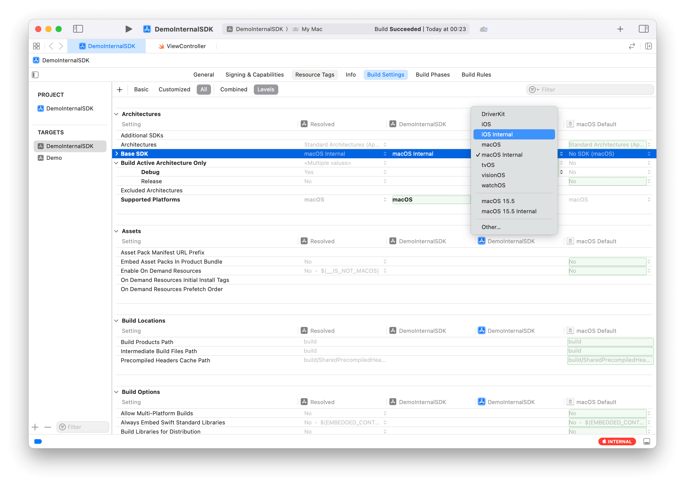
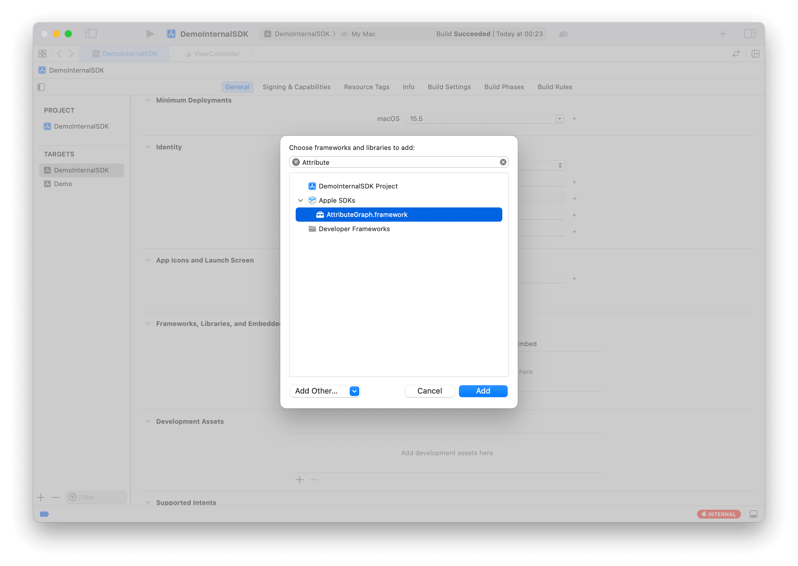
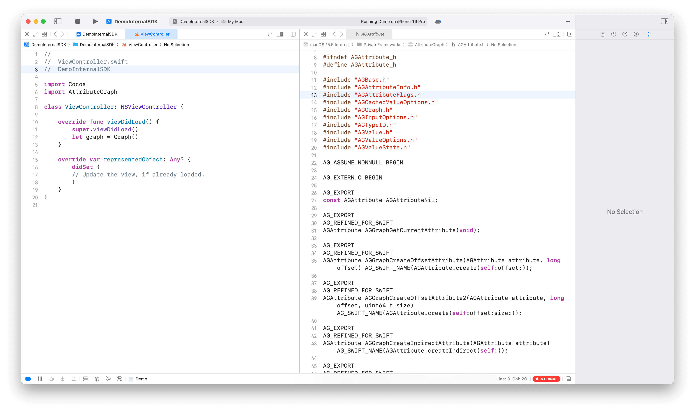

# DarwinPrivateFrameworks

| **CI Status** |
|---|
|[](https://github.com/OpenSwiftUIProject/DarwinPrivateFrameworks/actions/workflows/ag_example.yml)|
|[](https://github.com/OpenSwiftUIProject/DarwinPrivateFrameworks/actions/workflows/rb_example.yml)|
|[](https://github.com/OpenSwiftUIProject/DarwinPrivateFrameworks/actions/workflows/coreui_example.yml)|
|[](https://github.com/OpenSwiftUIProject/DarwinPrivateFrameworks/actions/workflows/bls_example.yml)|
|[](https://github.com/OpenSwiftUIProject/DarwinPrivateFrameworks/actions/workflows/gf_example.yml)|
|[](https://github.com/OpenSwiftUIProject/DarwinPrivateFrameworks/actions/workflows/sfsymbols_example.yml)|
|[](https://github.com/OpenSwiftUIProject/DarwinPrivateFrameworks/actions/workflows/featureflags_example.yml)|

This project contains private frameworks for Darwin platforms, including `AttributeGraph`, `RenderBox`, `CoreUI`, `BacklightServices`, `Gestures`, `SFSymbols`, and `FeatureFlags`.

The frameworks are provided as xcframeworks available for macOS, iOS Simulator, iOS[^1], visionOS Simulator, and visionOS platforms.

> [!CAUTION]
> These private frameworks are **ONLY** for research and educational purposes.
>
> **DO NOT** use them in App Store submissions or ship them to production/release environments.
>
> Using private frameworks in App Store apps will result in rejection and will crash your app in future OS update.

> [!WARNING]
> The scripts and xcframework code have only been tested on **macOS 15.5 and iOS 18.5**, and the visionOS support on **visionOS 2.5 with Xcode 26.6**. Other system versions are not guaranteed to work.
>
> Please resolve any compatibility issues yourself. Contributions are welcome!

## Structure

- `AG/`: Contains the `AttributeGraph` framework.
- `CoreUI/`: Contains the `CoreUI` framework.
- `BLS/`: Contains the `BacklightServices` framework.
- `Examples/`: Contains example projects demonstrating usage of the private frameworks.
- `GF/`: Contains the `Gestures` framework.
- `FeatureFlags/`: Contains the `FeatureFlags` Swift framework.
- `RB/`: Contains the `RenderBox` framework.
- `SFSymbols/`: Contains the `SFSymbols` framework.
- `Plugins/UpdateModule/`: Contains the `UpdateModule` plugin for updating the frameworks.

## Update

After editing the sources, you need to update the xcframeworks to reflect the changes.

To update the xcframework, run the following commands:

```shell
swift package update-xcframeworks --allow-writing-to-package-directory
```

### Device tbd Files

The visionOS device tbd files come from the dyld shared cache of a device
firmware. Use [ipsw](https://github.com/blacktop/ipsw) to download the firmware
and extract the cache:

```shell
brew install blacktop/tap/ipsw

# Download the visionOS 2.5 (22O473) Apple Vision Pro firmware (about 10.4 GB).
ipsw download ipsw --device RealityDevice14,1 --build 22O473 -o <firmware-dir>

# Extract the arm64e dyld shared cache. ipsw decrypts the AEA disk image.
ipsw extract --dyld -a arm64e -o <cache-dir> <firmware-dir>/<firmware>.ipsw
```

The cache is in `<cache-dir>/22O473__RealityDevice14,1/dyld_shared_cache_arm64e`.
Generate the tbd files from it, then run the update command above:

```shell
Scripts/generate_device_tbd.sh xros "<cache>" AttributeGraph RenderBox CoreUI BacklightServices CoreSVG SFSymbols FeatureFlags
```

The script extracts each framework with `ipsw dyld extract`, writes its tbd
with `xcrun tapi stubify --no-compact`, and adds the arm64 target next to the
arm64e target of the cache. The output goes to
`<Framework>/2024/tbds/xros-arm64-arm64e/`.

Download the whole firmware. `ipsw download ipsw --dyld` cannot extract the
cache remotely from this firmware, because its file system image is not in a
separate cryptex.

## Usage

> [!NOTE]
> If you are using [Tuist](https://tuist.dev), version **4.168.0** or later is required for `.tbd` stub file support in xcframeworks. See [tuist/tuist#9992](https://github.com/tuist/tuist/pull/9992) for details.

There are three ways supported to integrate and use these private frameworks:

### 1. For Swift Package Manager Projects

For Swift Package Manager projects, add the dependency as a normal package dependency in your `Package.swift` file:

```swift
dependencies: [
    .package(url: "https://github.com/OpenSwiftUIProject/DarwinPrivateFrameworks.git", from: "0.0.2"),
]
```

Then import and use the frameworks directly in your Swift code.

### 2. For Xcode Project

For Xcode projects, first add the dependency as above and then manually drag the corresponding xcframework into your project:

1. Locate the xcframework (e.g., `AG/2024/AttributeGraph.xcframework`)
2. Drag it into your Xcode project's target Frameworks section

> Alternatively, you could copy the corresponding AG binary directly into the framework directory of this repository to avoid manully xcframework adding.
>
> However, for maintainability and file size considerations, this approach is not currently used.
>
> In the future, once the project is stable, we may consider publishing a complete xcframework on GitHub for direct dependency.

### 3. Globally use via Internal SDK

1. Use the following installation script to set up an internal SDK to use these private frameworks[^2] globally:

```shell
# For macOS
Scripts/SDK/install_internal_sdk.sh MacOSX

# For iOS Simulator
Scripts/SDK/install_internal_sdk.sh iPhoneSimulator

# For iOS Device
Scripts/SDK/install_internal_sdk.sh iPhoneOS

# For visionOS Simulator (legacy, see the visionOS section below)
Scripts/SDK/install_internal_sdk.sh XRSimulator
```

2. Choose the corresponding Internal SDK as the Base SDK in your Xcode project settings.



> **SDK Selection Guidelines:**
>
> - **Xcode < 16.3**: You can use the auto-detected "Internal SDK" (eg. macOS Internal SDK which corresponds to `macosx.internal`), or manually enter the full canonical name (e.g. `macosx15.5.internal`).
> - **Xcode ≥ 16.3**: You must use the full canonical name for all platforms due to Xcode's stricter SDK detection:
>
> For example:
> - macOS: `macosx15.5.internal`
> - iOS Simulator: `iphonesimulator18.5.internal`
> - iOS Device: `iphoneos18.5.internal`
> - visionOS Simulator: `xrsimulator2.0.internal`
>
> To get the current supported canonical name, you can run `xcodebuild -showsdks` after installing the SDK.
>
> **Note**: Command-line `xcodebuild` with `-sdk macosx.internal` works regardless of Xcode version.
>
> Similar report: https://github.com/insidegui/researchsdk/commit/71259b0a0e8c92ba31131acbe024096fbe096844

3. In your target's General tab, add the corresponding private framework shown in Apple SDKs part to the "Frameworks, Libraries, and Embedded Content" section.



4. In your Swift code, import the frameworks as needed:

```swift
import AttributeGraph
```



## visionOS Support

The public visionOS SDKs mark `UIScreen`, `UIWindow.screen`, and
`UIDevice.orientation` unavailable. UIKit implements them at runtime. Projects
that use these APIs on visionOS can generate a compiler virtual file system
overlay. The overlay replaces only `UIScreen.h`, `UIWindow.h`, and `UIDevice.h`
of the visionOS and visionOS Simulator SDKs in the selected Xcode:

```shell
export DEVELOPER_DIR=/Applications/Xcode.app/Contents/Developer
Scripts/XR/install_xr_uikit_overlay.sh
```

The script writes `~/Library/Developer/OpenSwiftUI/XR/overlay.yaml`
together with the patched headers and a `manifest.json` that records the Xcode
and SDK builds. Pass `--output <dir>` to use a different directory. Add the
overlay to the consuming project:

```xcconfig
OTHER_CFLAGS[sdk=xros*] = $(inherited) -ivfsoverlay $(HOME)/Library/Developer/OpenSwiftUI/XR/overlay.yaml
OTHER_SWIFT_FLAGS[sdk=xros*] = $(inherited) -vfsoverlay $(HOME)/Library/Developer/OpenSwiftUI/XR/overlay.yaml
OTHER_CFLAGS[sdk=xrsimulator*] = $(inherited) -ivfsoverlay $(HOME)/Library/Developer/OpenSwiftUI/XR/overlay.yaml
OTHER_SWIFT_FLAGS[sdk=xrsimulator*] = $(inherited) -vfsoverlay $(HOME)/Library/Developer/OpenSwiftUI/XR/overlay.yaml
```

The SDK inside Xcode stays unchanged, and the private frameworks come from the
xcframeworks as usual. Run the script again after switching Xcode.

Pass `--sdk` to also write `XRSimulator.additions.sdk`, a UIKit-only visionOS
Simulator additions SDK for projects that prefer the `ADDITIONAL_SDKS` build setting:

```xcconfig
ADDITIONAL_SDKS[sdk=xrsimulator*] = $(inherited) $(HOME)/Library/Developer/OpenSwiftUI/XR/XRSimulator.additions.sdk
```

The legacy `install_internal_sdk.sh XRSimulator` path copies the whole SDK into
Xcode and patches the same headers there. Prefer the overlay for new setups.
The private frameworks come from the xcframeworks on every path.

[^1]: The Swift API of AttributeGraph is not available on iOS platform.

[^2]: The installer currently includes AttributeGraph, RenderBox, CoreUI, BacklightServices, SFSymbols, and Gestures (platform-dependent). For visionOS, the script also enables UIScreen support by removing API availability restrictions.
